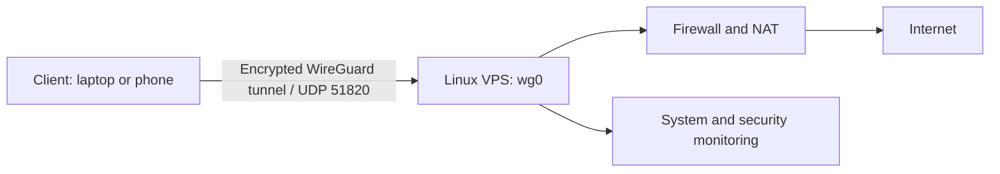

# NetivoVPN — Secure VPN Infrastructure

> **Portfolio status:** historical project documented; deployment and testing are **not independently verified** as of 2026-11-21. This repository contains original documentation, sanitized example configurations, and a validation procedure—not a claim of a functioning production VPN.

## Overview

NetivoVPN is a self-hosted VPN infrastructure project focused on secure remote access, Linux server hardening, and WireGuard tunneling. It was originally explored using rented DigitalOcean VPS infrastructure. The current portfolio presentation uses an **original WireGuard/Linux implementation** rather than redistributing any third-party Android template.

**Skills demonstrated through this documentation:** VPN architecture, key management concepts, network segmentation, NAT, firewall planning, operational verification, threat modeling, and honest evidence handling.

## Architecture (proposed / reconstruction reference)

No proprietary BYCOM/BICOM source, actual secrets, real peer configs, public server addresses, or private keys are included.

## Project history vs independently verified status

| Item | Historical account | Currently verified by original artifacts? |
|---|---|---|
| DigitalOcean VPS rented for project | User described using DigitalOcean infrastructure | No |
| WireGuard tunnel | Earlier discussion referenced handshake / transfer screenshots | No source screenshots currently available |
| Tunnel addresses and client | Earlier discussion referred to a client tunnel | No original config currently available |
| Android application | BYCOM VPN 2.5 template was acquired, but later decision was to avoid that third-party template | No original app build or source verified |
| DNS leak protection / kill switch | Planned capability | Not tested |
| Zero-log guarantee | Discussed as a goal | Not audited; **not claimed** |
| Multi-region, billing, production service | Product ideas | Not verified |

## Repository contents

- [`docs/ARCHITECTURE.md`](docs/ARCHITECTURE.md) — network design, threat boundaries and responsibilities.
- [`docs/SECURITY.md`](docs/SECURITY.md) — key protection, logging, and publication safety.
- [`docs/VALIDATION.md`](docs/VALIDATION.md) — repeatable commands and pass/fail criteria.
- [`docs/PROJECT_HISTORY.md`](docs/PROJECT_HISTORY.md) — historical record with evidence limitations.
- [`evidence/README.md`](evidence/README.md) — artifact index and instructions for sanitized screenshots.
- [`configs/wg0.example.conf`](configs/wg0.example.conf) — **non-functional example**, placeholders only.
- [`scripts/collect-safe-evidence.sh`](scripts/collect-safe-evidence.sh) — local evidence collection with redaction reminders.

## Reproduction outline

1. Provision a dedicated Linux VPS with supported security updates.
2. Generate WireGuard keys **locally** and store secrets outside Git.
3. Configure the VPN interface, IP forwarding, a restrictive host firewall, and narrowly scoped NAT.
4. Enroll a test client and validate handshake, assigned route, DNS behavior, and reconnect behavior.
5. Redact IP addresses, key material, usernames and sensitive metadata from evidence before uploading.
6. Record **actual** results and the date in [`docs/VALIDATION.md`](docs/VALIDATION.md).

The checked-in example is intentionally not executable without being rewritten for your authorized environment.

## Portfolio integrity

This is a **reconstruction/documentation repository**, not a certified no-logs service or penetration test report. Do not mark historical demonstrations as verified until primary artifacts or freshly reproduced tests are available.

## Owner

NetivoVPN project — portfolio documentation, 2026. The original Android application/template is **not** distributed here.
