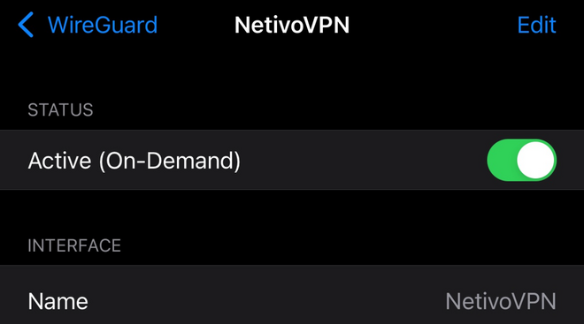
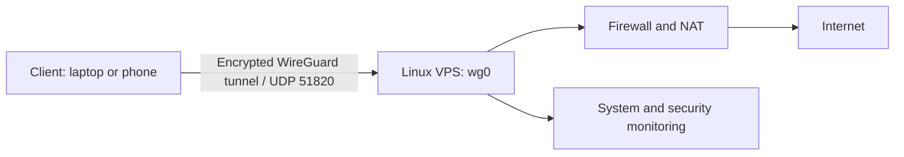

# NetivoVPN (2025) — WireGuard VPN on iOS

In 2025 I used NetivoVPN on my iPhone through the WireGuard app. I installed WireGuard, created a tunnel named NetivoVPN and configured the server as its peer. The profile specified the server endpoint and peer public key, the client's tunnel addresses, DNS resolvers and allowed routes. Activating that profile gave me an encrypted VPN connection on iOS.

The same client setup applies to a MacBook running macOS. The [client screenshots](evidence/README.md#mobile-client) document the iPhone session. The MacBook photos show Android Studio, where I worked on a separate Android prototype.

The Hetzner dashboard shows one server, one firewall and one network. The iPhone screenshots show on-demand activation and default routes for IPv4 and IPv6.

[View the original lab captures and findings](evidence/README.md)

The client recorded 296 bytes sent. A peer handshake, return traffic, public egress and DNS behavior remain open validation items. The configuration and architecture below are reconstruction examples.

## Architecture (proposed / reconstruction reference)

No proprietary BYCOM/BICOM source, actual secrets, real peer configs, public server addresses, or private keys are included.

## Project history vs independently verified status

| Item | Historical account | Currently verified by original artifacts? |
|---|---|---|
| Hetzner Cloud | Project dashboard | Server, firewall and network visible |
| DigitalOcean VPS rented for project | User described using DigitalOcean infrastructure | No |
| WireGuard tunnel | I used the configured WireGuard tunnel on iOS in 2025 | iOS profile active and sent counter visible. Handshake unverified |
| Tunnel addresses and client | Earlier discussion referred to a client tunnel | Client configuration visible in original screenshots |
| Android application | BYCOM VPN 2.5 template was acquired, but later decision was to avoid that third-party template | [Android Studio project, successful Gradle task and runtime crash documented](evidence/README.md#android-prototype-in-android-studio). APK and source provenance unverified |
| DNS leak protection / kill switch | Planned capability | Not tested |
| Zero-log guarantee | Discussed as a goal | Not audited; **not claimed** |
| Multi-region, billing, production service | Product ideas | Not verified |

## Repository contents

- [`docs/ARCHITECTURE.md`](docs/ARCHITECTURE.md) — network design, threat boundaries and responsibilities.
- [`docs/SECURITY.md`](docs/SECURITY.md) — key protection, logging, and publication safety.
- [`docs/VALIDATION.md`](docs/VALIDATION.md) — repeatable commands and pass/fail criteria.
- [`docs/PROJECT_HISTORY.md`](docs/PROJECT_HISTORY.md) — historical record with evidence limitations.
- [`evidence/README.md`](evidence/README.md) — artifact index and instructions for sanitized screenshots.
- [`configs/wg0.example.conf`](configs/wg0.example.conf) — **non-functional example**, placeholders only.
- [`scripts/collect-safe-evidence.sh`](scripts/collect-safe-evidence.sh) — local evidence collection with redaction reminders.

## Reproduction outline

1. Provision a dedicated Linux VPS with supported security updates.
2. Generate WireGuard keys **locally** and store secrets outside Git.
3. Configure the VPN interface, IP forwarding, a restrictive host firewall, and narrowly scoped NAT.
4. Enroll a test client and validate handshake, assigned route, DNS behavior, and reconnect behavior.
5. Redact IP addresses, key material, usernames and sensitive metadata from evidence before uploading.
6. Record **actual** results and the date in [`docs/VALIDATION.md`](docs/VALIDATION.md).

The checked-in example is intentionally not executable without being rewritten for your authorized environment.

## Portfolio integrity

This is a **reconstruction/documentation repository**, not a certified no-logs service or penetration test report. Do not mark historical demonstrations as verified until primary artifacts or freshly reproduced tests are available.

## Owner

**Alejandro Báez Santana** created NetivoVPN in 2025. He developed the original idea, designed and deployed the VPN infrastructure on Hetzner Cloud, and configured the encrypted tunnel on iOS using the WireGuard app.

[GitHub profile](https://github.com/Alexcyberdr)

NetivoVPN project, 2025. Portfolio documentation published in 2026. The original Android application/template is **not** distributed here.
