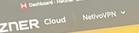
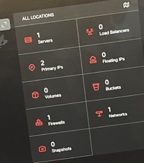
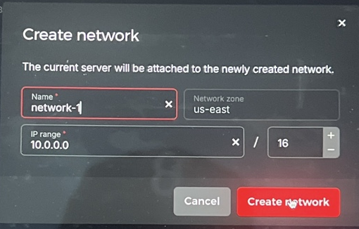
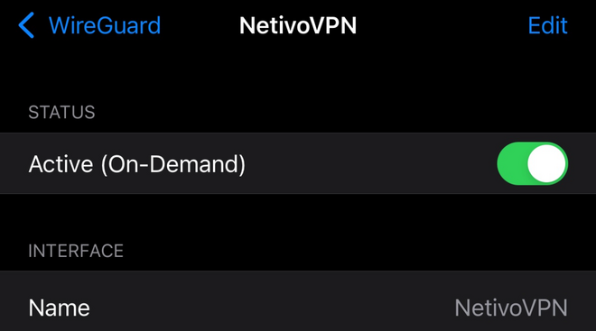
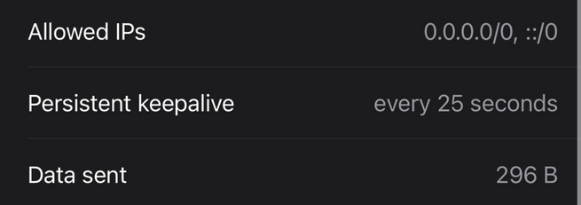
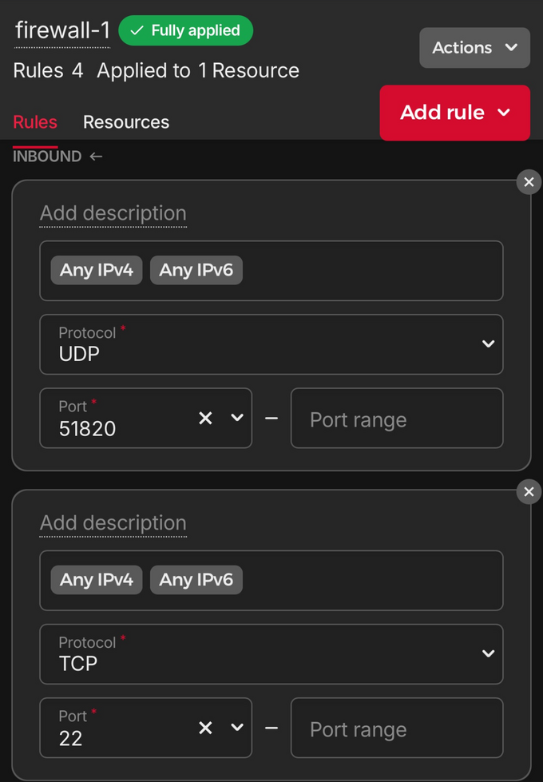
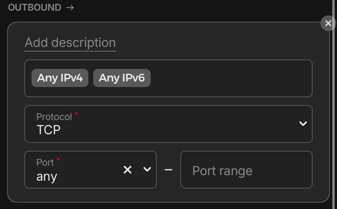
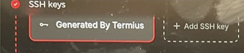
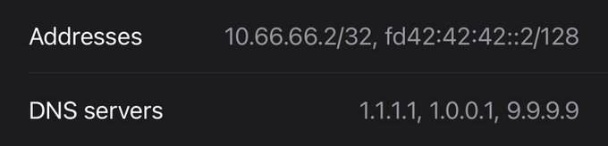
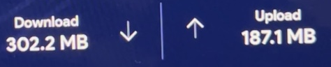

# NetivoVPN lab evidence

These excerpts come from the project owner's original photos and iPhone screenshots. The crops preserve the visible settings and counters while excluding credentials and public endpoints.

## Cloud infrastructure

The Hetzner Cloud dashboard identifies NetivoVPN and lists one server, one firewall and one network. The network creation form shows the proposed private range `10.0.0.0/16` in `us-east`. The firewall views below show the applied cloud policy. The final private subnet assignment still needs verification.

## Mobile client

The WireGuard app shows NetivoVPN active on demand. The peer view shows both default routes, a 25-second keepalive and 296 bytes sent. The iOS detail page records a connection timer of 1:25. These observations document client state. Verifying an end-to-end tunnel still requires a recent handshake and traffic received from the peer.

See the [validation checklist](../docs/VALIDATION.md) for the outstanding server, routing and DNS tests.

## Cloud firewall and SSH troubleshooting

Hetzner reports four rules applied to one resource. Two visible inbound rules allow UDP 51820 and TCP 22 from any IPv4 or IPv6 source. The outbound view shows TCP to any destination port. The screenshots leave the fourth rule unspecified. SSH administration was open to all source addresses at the cloud firewall layer.

The provisioning screen shows an SSH key labeled “Generated By Termius.” A separate mobile attempt timed out. The SSH client targeted a different IPv4 address from the configured VPN endpoint: its first octet was 51 instead of 5. That discrepancy gives a specific setting to check. The available captures do not establish the cause of the timeout or a successful SSH login.

## Additional mobile configuration

One WireGuard profile view shows both an IPv4 and an IPv6 interface address and three configured DNS resolvers. A resolver leak test remains outstanding.

## Traffic counters awaiting attribution

A separate VPN interface displayed 302.2 MB downloaded and 187.1 MB uploaded. Its visible screen does not identify NetivoVPN or its WireGuard peer. These counters are excluded from the project's verified transfer results.

